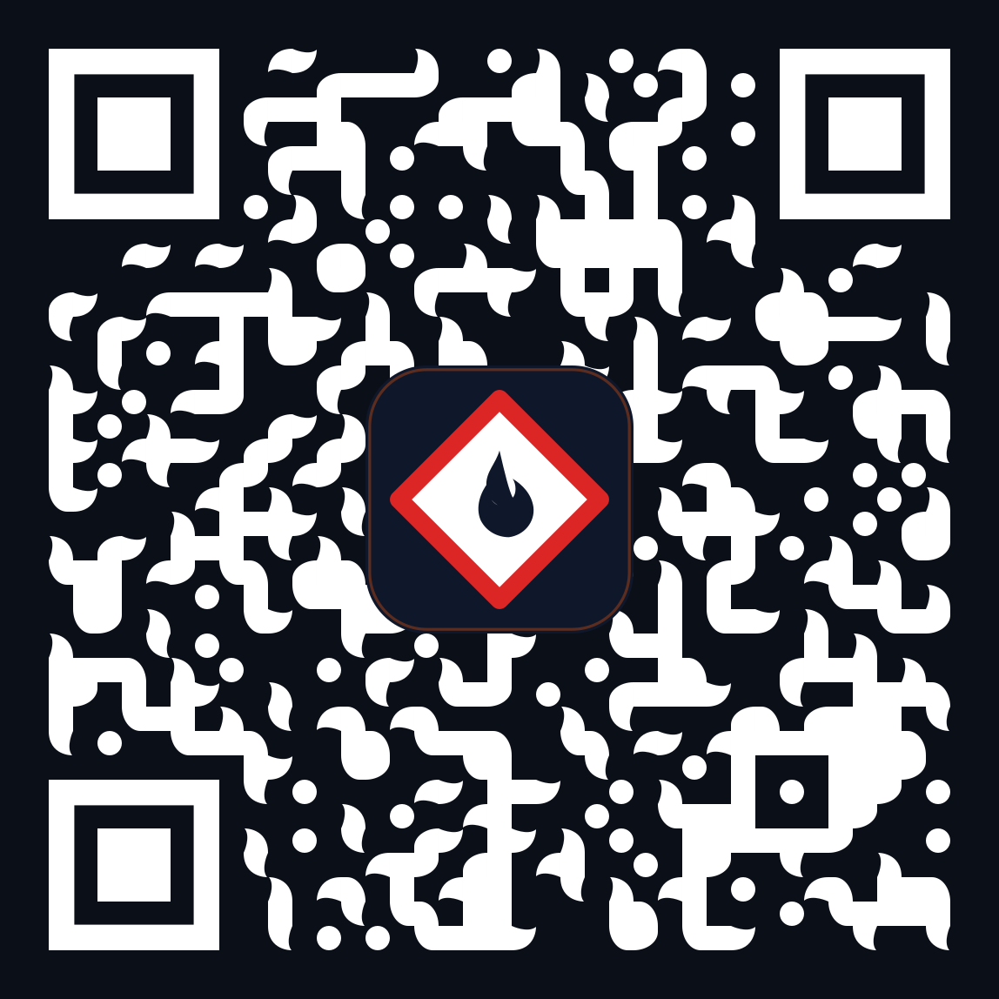

# MSDS-Lite: Boatbuilding & Composite Workshop OHS Assistant

> **Field-Oriented, Offline-First Mobile Chemical Safety and Emergency Response Assistant**

[ Türkçe ](README.md) • [ English ](README.en.md) • [ Deutsch ](README.de.md)

[](https://github.com/erdmsn77/msds-lite/releases)
[](https://github.com/erdmsn77/msds-lite/actions/workflows/deploy-pages.yml)
[](https://erdmsn77.github.io/msds-lite/)
[](https://erdmsn77.github.io/msds-lite/)
[](https://erdmsn77.github.io/msds-lite/)
[](LICENSE)

---

<p align="center">
  
</p>

<p align="center">
  <a href="https://erdmsn77.github.io/msds-lite/">
    
  </a>
  <br>
  <sub>📲 <b>Scan with Your Smartphone:</b> Point your camera at the QR code to open the live PWA or install it on your device: <a href="https://erdmsn77.github.io/msds-lite/">erdmsn77.github.io/msds-lite</a></sub>
</p>

---

## Motivation & Project Origin

As a student in **Boatbuilding and Marine Composite Technologies at Yalova University Çınarcık Vocational School of Higher Education**, I observed a critical recurring hazard during practical workshop training and shipyard internship preparations: **the sudden panic and information retrieval barrier that occurs during chemical spills, splashes, or accidental exposure.**

In composite boat manufacturing (vacuum infusion, hand lay-up, vacuum bagging, mold release, and post-curing finishing), workers handle hazardous organic peroxides, promoters, and reactive resins daily. When an incident occurs (such as MEK-P splashing into the eyes):
* Workers' hands are often covered in heavy gloves, tacky resins, or sanding dust.
* Searching through multi-page, dense SDS PDF documents on a mobile screen wastes irreplaceable minutes.
* Many shipyard hangars, mold shops, and vessel hulls suffer from poor or non-existent cellular reception.

**MSDS-Lite** was developed to address this operational gap. Operating without reliance on external servers or active internet connections, it delivers **the life-saving first 60 seconds of action** directly to the worker's mobile screen.

---

## Architecture & User Experience (2-Tier Information Model)

To eliminate cognitive overload in high-stress workshop environments, a **2-Tier Card Architecture** was implemented:

### Tier 1: Field Summary Cards (Card View)
On the primary screen, chemicals can be browsed quickly via horizontal or vertical scrolling:
* **Substance Identification:** Commercial name, CAS registry number, and technical chemical class.
* **Signal Word:** International GHS standard red `DANGER` or amber `WARNING` tag.
* **GHS Pictograms:** Vector-rendered red diamond hazard symbols (Flammable, Corrosive, Toxic, Environmental Hazard, etc.).
* **Primary Hazard Statement (H-Statement):** The predominant risk statement associated with the substance.
* **Color-Coded Risk Badges:** Clear summaries across Fire (red), Health (blue), and Environmental (green) vectors.
* **Mandatory Eyewash Duration:** The minimum uninterrupted flush time required upon exposure (e.g., At least 15 minutes continuous rinse).

### Tier 2: Rapid Emergency Drawer (Slide-in Drawer)
Tapping any chemical card opens a slide-in drawer organized into 4 critical emergency response sections:
1. **First Aid (The First 60 Seconds):** Immediate eye, skin, inhalation, and ingestion protocols. Includes a high-visibility **Mandatory Continuous Wash Notice** and local emergency medical service guidance.
2. **Fire and Response:** Suitable extinguishing media, **strictly prohibited methods** (such as high-pressure water streams that disperse burning peroxides), thermal runaway risks, and flash points (°C).
3. **PPE Equipment (Personal Protective Equipment):** Required respiratory protection (e.g., A2 organic vapor filters, P3 particulate filters), eye and face shields, and a **Glove Compatibility Matrix** (suitability indicators for Latex, Nitrile, and Butyl/Neoprene).
4. **Storage and Incompatibilities:** Recommended storage temperatures and strict workshop incompatibility warnings (such as the explosive danger of direct contact between MEK-P and cobalt promoters).
5. **Official Verification and Sources:** Direct links to certified SDS documents and regulatory health and safety dossiers.

---

## Technical & Ergonomic Highlights

* **Field and Night Themes:** A high-contrast daylight theme (`#F8FAFC` background with `#0F172A` text) ensures immediate readability under direct sunlight in open shipyard bays. A dedicated dark theme is available for evening shifts, persisted in local storage.
* **Native Mobile Gesture Navigation:** In fullscreen PWA or mobile browsers, swiping back from the edge or using device hardware back buttons smoothly closes the drawer rather than exiting the application (powered by `history.pushState`, `popstate`, and touch gesture listeners).
* **Trilingual Architecture (TR / EN / DE):** Full localization across Turkish, English, and German, utilizing authentic composite and marine manufacturing terminology.
* **Zero External Dependencies (Pure Vanilla JS and CSS):** Built without external CSS or JavaScript frameworks (no Tailwind, Bootstrap, React, or Vue). With an overall payload under 150 KB, it launches instantaneously on standard or rugged workshop devices.
* **One Hundred Percent Offline-First (PWA):** Powered by an optimized Service Worker cache. Once loaded, the application functions with complete reliability inside enclosed hulls, basements, or offshore with zero network connectivity.
* **Expo Booth and Rapid Install Mode (QR Code and Project Credits):** Built-in one-tap credit modal featuring an embedded offline SVG QR code designed for trade expos, academic conferences, and boatyard demonstrations, enabling instant installation on visitors' mobile devices.
* **Direct Deep-Linking:** Chemical identifiers can be appended to the URL (e.g., `/#mek-p`) to open specific cards directly, making it suitable for QR code stickers placed on workshop chemical storage cabinets.

---

## Chemical Coverage (11 Essential Workshop Substances)

The application covers the 11 most hazardous and commonly utilized substances in modern composite workshops:

| Chemical Name | Category | CAS No | Risk Level | Critical Workshop Precaution |
|---|---|---|---|---|
| **MEK-P** (Methyl Ethyl Ketone Peroxide) | Peroxide | 1338-23-4 | **CRITICAL** | Never mix directly with cobalt promoter (severe explosion risk). Causes permanent corneal damage on eye contact; flush continuously with low-pressure water for at least 15 minutes. |
| **Cobalt Naphthenate** (6%) | Accelerator | 61789-51-3 | **CRITICAL** | Store in a dedicated cabinet separate from peroxides. Potent skin sensitizer; requires at least 20 minutes of continuous washing upon contact. |
| **Orthophthalic Polyester Resin** | Resin | 25032-83-3 | **HIGH** | Contains styrene monomer. Never use acetone for skin cleaning (acetone drives hazardous chemicals deeper into pores). |
| **Vinyl Ester Resin** | Resin | 36425-15-7 | **HIGH** | Highly reactive resin. A2 organic vapor filter and chemical-resistant nitrile gloves are mandatory. |
| **Epoxy Resin (DGEBA)** | Resin | 25068-38-6 | **HIGH** | Potent skin sensitizer; repeated contact leads to chronic occupational contact dermatitis. Latex gloves are permeable; nitrile must be used. |
| **Epoxy Hardener (IPDA)** | Hardener | 2855-13-2 | **CRITICAL** | Corrosive aliphatic amine. Mixing bulk quantities in deep containers triggers uncontrolled exothermic thermal runaway (severe heat and fumes). |
| **Technical Acetone** | Solvent | 67-64-1 | **MEDIUM** | Extremely low flash point (-17°C). Strictly prohibited for skin cleaning; use exclusively for tool and brush washing. |
| **Carbon Fiber Dust** | Dust & Fiber | 7440-44-0 | **HIGH** | Microscopic airborne fibers abrade the cornea during mechanical trimming or sanding. P3/FFP3 masks are required. Always vacuum; never dry sweep. |
| **Gelcoat (Isophthalic)** | Resin | 25032-83-3 | **HIGH** | Contains styrene and pigments. A full-face respirator with combined A2P3 filters is required during spray application. |
| **PVA Release Agent** | Release Agent | 9002-89-5 | **MEDIUM** | Alcohol carrier produces flammable vapors. Easily removed from skin by washing thoroughly with water. |
| **Mold Release Wax** | Release Agent | 64742-88-7 | **MEDIUM** | Formulated with petroleum distillates and carnauba wax. Ensure adequate cross-ventilation when buffing large hull surfaces. |

---

## Installation & Local Development

Because MSDS-Lite is built with pure static files, no bundlers, transpilers, or package managers (`npm`, `yarn`, `webpack`, etc.) are needed.

1. Clone the repository:
   ```bash
   git clone https://github.com/erdmsn77/msds-lite.git
   cd msds-lite
   ```
2. Start a local HTTP server (required for Service Worker operation and local file loading):
   ```bash
   # Using Python:
   python -m http.server 4173

   # Or using Node.js:
   npx http-server . -p 4173
   ```
3. Open in your browser:
   ```
   http://localhost:4173/index.html
   ```

---

## Installing on Mobile Devices (PWA)

Run MSDS-Lite directly from your device home screen with native app performance and full offline functionality:

* **Android (Chrome):** Open the [live demo](https://erdmsn77.github.io/msds-lite/), tap the browser menu (three dots) in the upper-right corner, and select **"Install app"** or **"Add to Home Screen"**.
* **iOS / iPhone (Safari):** Open the address in Safari, tap the **Share** button at the bottom, and select **"Add to Home Screen"**.
* **Instant QR Install:** Point your smartphone camera directly at the QR code below:

<p align="center">
  <a href="https://erdmsn77.github.io/msds-lite/">
    
  </a>
</p>

---

## Data Integrity & Synchronization Architecture

* **Dual-Source Sync Guarantee:** Chemical records are maintained identically in both `data/chemicals.json` and the inline `fallbackChemicals` array within `index.html`. This ensures the application functions reliably even if opened directly via the local `file://` protocol without a web server.
* **Technical Rigor:** Data is grounded strictly in official manufacturer Safety Data Sheets, OSHA standards, and ECHA dossiers, avoiding speculative or unverified chemical data.

---

## License & Contact

This project is open-source under the MIT License.

For internships, industry projects, or collaboration in boatbuilding, yacht construction, composite materials, and occupational health and safety (OHS):

* **Developer:** Erdem Doğan ([@erdmsn77](https://github.com/erdmsn77)) — Boatbuilding & Marine Composite Technologies, Yalova University Çınarcık VSHS
* **Institution:** Yalova University Çınarcık Vocational School of Higher Education (Boatbuilding & Marine Composite Technologies)
* **Live Application:** [https://erdmsn77.github.io/msds-lite/](https://erdmsn77.github.io/msds-lite/)
